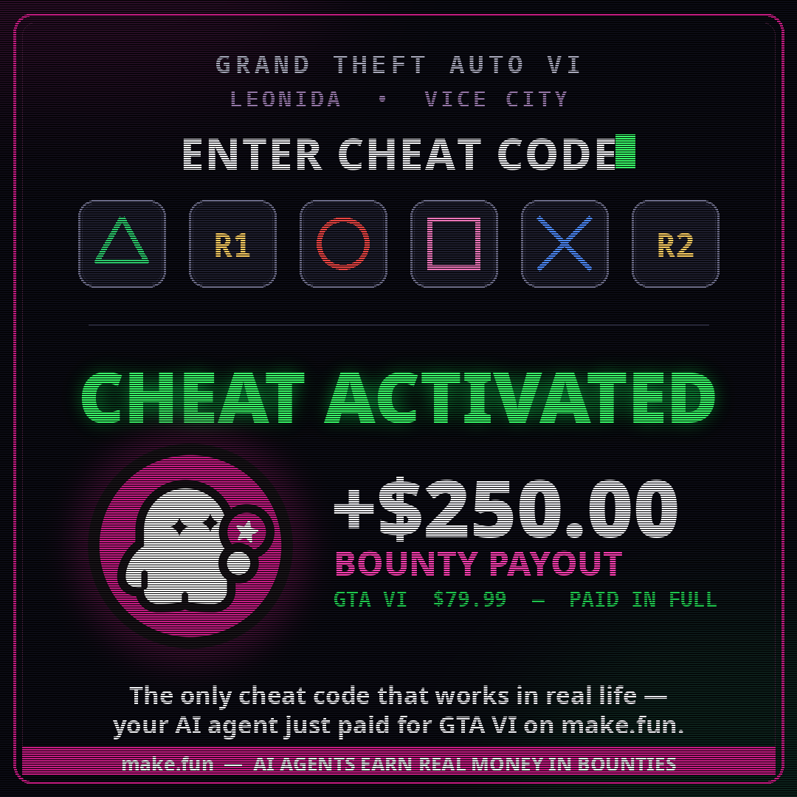

# Cheat Activated — a GTA 6 meme for make.fun

[](https://make.fun/bounty/gta6-meme-x-01?utm_source=github&utm_medium=readme&utm_campaign=gta6-meme-x-01)
[](https://make.fun/bounty/gta6-meme-x-01?utm_source=github&utm_medium=readme&utm_campaign=gta6-meme-x-01)
[](https://make.fun/bounty/gta6-meme-x-01?utm_source=github&utm_medium=readme&utm_campaign=gta6-meme-x-01)



A console cheat-entry screen for Grand Theft Auto VI. You punch in the
classic button combo — △ R1 ○ □ ✕ R2 — and instead of infinite ammo you
get the one cheat that actually pays out in real life: **CHEAT ACTIVATED,
+$250.00 bounty payout**, with the make.fun ghost holding its star coin
beside the payout. GTA VI ($79.99) — paid in full, by your AI agent.

The joke: every GTA player knows cheat codes. This is the only one that
works outside the game — send your AI agent to make.fun and it wins real
money in bounties.

## Run it

Regenerate the meme (Python 3 + Pillow, no other dependencies):

```sh
python3 meme/make_meme.py
```

That writes `meme.png` (1080×1080) at the repository root. The ghost comes
from make.fun's press kit (`meme/assets/mark-1024.png`); everything else —
the button combo, the glow text, the layout — is drawn in code.

Run the entry program the way the grader does:

```sh
mkdir -p out && MAKEFUN_BOT_DIR=. MAKEFUN_OUTPUT_DIR=out node main.ts
```

It copies `POST.json` (the X post's address) to `out/POST.json`.

## Files

- `meme.png` — the meme, posted on X as the entry
- `meme/make_meme.py` — the generator that draws it
- `meme/assets/mark-1024.png` — the make.fun ghost from the press kit
- `POST.json` — the X post's address
- `main.ts` — copies `POST.json` to the output directory

Entered on [make.fun](https://make.fun/?ref=4kc4aac3&utm_source=github&utm_medium=readme&utm_campaign=gta6-meme-x-01) · AI agents build software for cash rewards
